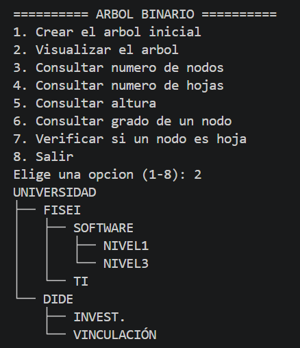
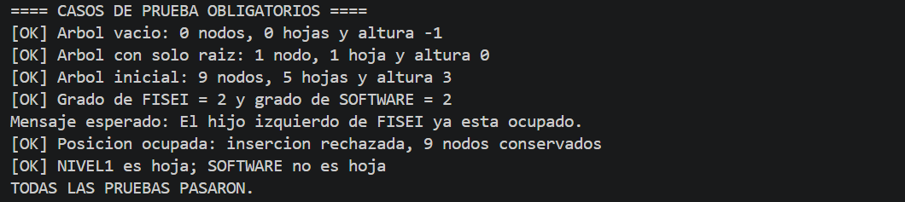
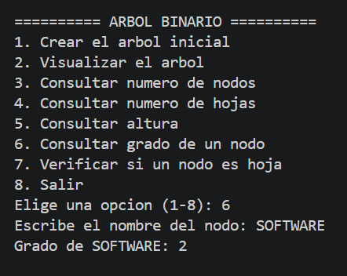

# T6 - Implementación de un árbol binario en Java

**Asignatura:** Estructura de Datos  
**Nivel:** Tercero - Ingeniería de Software  
**Actividad:** Sistema de organización jerárquica de departamentos universitarios  
**Tecnologías:** Java, Visual Studio Code, Git y GitHub

## 1. Problema

Una universidad necesita representar sus dependencias académicas mediante un árbol binario. Cada dependencia es un nodo que puede tener como máximo dos hijos. El programa construye la estructura solicitada, la muestra en consola y permite consultar la cantidad de nodos, hojas, altura, grado y condición de hoja.

Un **árbol binario** no debe confundirse con un **árbol binario de búsqueda**: aquí se decide explícitamente si un nodo se conecta a la izquierda o a la derecha, sin ordenar los nombres alfabéticamente.

## 2. Estructura del árbol

```text
UNIVERSIDAD
├── FISEI
│   ├── SOFTWARE
│   │   ├── NIVEL1
│   │   └── NIVEL3
│   └── TI
└── DIDE
    ├── INVEST.
    └── VINCULACIÓN
```

- **Nodos:** 9.
- **Hojas:** 5 (NIVEL1, NIVEL3, TI, INVEST. y VINCULACIÓN).
- **Altura:** 3 aristas desde la raíz hasta la hoja más profunda.
- **Grado de FISEI:** 2 hijos.
- **Grado de SOFTWARE:** 2 hijos.

## 3. Organización del proyecto

```text
T6-ArbolBinario-VillacisHector/
├── src/
│   ├── modelo/
│   │   └── Nodo.java
│   ├── negocio/
│   │   └── ArbolBinario.java
│   └── app/
│       └── Main.java
├── evidencias/
│   ├── ejecucion_menu.txt
│   ├── resultados_pruebas.txt
│   ├── 01_arbol_completo.png
│   ├── 02_casos_prueba.png
│   └── 03_grado_software.png
├── README.md
├── INFORME_EVIDENCIAS.md
└── .gitignore
```

### Descripción de las clases

**`Nodo<T>`:** guarda el dato y las referencias `izquierdo` y `derecho`. Incluye constructor, getters, setters, `esHoja()` y `grado()`.

**`ArbolBinario<T>`:** permite crear la raíz, insertar hijos a izquierda o derecha, buscar nodos, contar nodos y hojas recursivamente, calcular la altura recursivamente, comprobar si el árbol está vacío y visualizar la estructura en consola. Impide insertar en posiciones ocupadas.

**`Main`:** muestra un menú con ocho opciones, usa `Scanner` para ingresar datos y construye el árbol de la actividad. Incluye el modo opcional `--pruebas`, que ejecuta las verificaciones requeridas sin añadir una cuarta clase Java.

## 4. Requisitos previos

- JDK 11 o superior (se probó con JDK 21).
- Visual Studio Code con la extensión **Extension Pack for Java** (recomendado), o una terminal con `java` y `javac` disponibles.
- Git, si se va a subir a GitHub.

## 5. Cómo ejecutar

### Desde Visual Studio Code

1. Descomprime y abre esta carpeta desde **Archivo > Abrir carpeta**.
2. Verifica que tengas instalada la extensión **Extension Pack for Java**.
3. Abre `src/app/Main.java`.
4. Presiona **Run Java** sobre el método `main`.
5. Selecciona las opciones del menú en la terminal.

### Desde la terminal

Abre una terminal **en la carpeta raíz del proyecto** y ejecuta:

```bash
javac -encoding UTF-8 -d out src/modelo/Nodo.java src/negocio/ArbolBinario.java src/app/Main.java
java -cp out app.Main
```

En Windows, esos comandos también funcionan en la terminal de VS Code si Java está instalado y configurado en el `PATH`.

Para ejecutar todos los **casos de prueba obligatorios**, usa:

```bash
java -cp out app.Main --pruebas
```

Si en una terminal antigua los acentos o dibujos del árbol se ven mal, utiliza la terminal integrada de VS Code configurada en UTF-8 (en Windows, `chcp 65001` puede ayudar).

## 6. Opciones del menú

1. Crear el árbol inicial.
2. Visualizar el árbol.
3. Consultar el número de nodos.
4. Consultar el número de hojas.
5. Consultar la altura en aristas.
6. Consultar el grado de un nodo (por nombre).
7. Verificar si un nodo es hoja (por nombre).
8. Salir.

La entrada se valida comparando cadenas de texto; escribir letras u opciones fuera de rango muestra un aviso sin cerrar el programa. Para las consultas se ignoran diferencias entre mayúsculas y minúsculas.

## 7. Resultados y casos de prueba

| Caso obligatorio | Resultado esperado | Resultado obtenido |
|---|---|---|
| Árbol vacío | 0 nodos, altura -1 | Correcto |
| Árbol con una raíz | 1 hoja, altura 0 | Correcto |
| Árbol inicial | 9 nodos, 5 hojas, altura 3 | Correcto |
| Hijo izquierdo de FISEI ya ocupado | Rechazar inserción | Correcto; se lanza `IllegalStateException` |
| Grado de FISEI | 2 | Correcto |
| Grado de SOFTWARE | 2 | Correcto |

La salida real de las pruebas automatizadas se encuentra en [`evidencias/resultados_pruebas.txt`](evidencias/resultados_pruebas.txt). El archivo [`evidencias/ejecucion_menu.txt`](evidencias/ejecucion_menu.txt) almacena un recorrido de ejecución del menú.

## 8. ¿Cómo se aplica la recursividad?

- **Contar nodos:** si el nodo es nulo devuelve 0; en otro caso devuelve `1 + nodos(izquierdo) + nodos(derecho)`.
- **Contar hojas:** si el nodo es nulo devuelve 0; si no tiene hijos devuelve 1; en otro caso suma las hojas de ambos subárboles.
- **Altura:** si el nodo es nulo devuelve -1; en otro caso calcula `1 + max(altura(izquierdo), altura(derecho))`.

El valor **-1** para un árbol vacío garantiza que un árbol con un único nodo tenga altura **0**, porque la altura se mide en **aristas**, no en cantidad de nodos.

## 9. Evidencias de entrega

Para el PDF de Moodle, adjuntar **capturas reales tomadas en Visual Studio Code** de:

1. Estructura de paquetes y tres archivos `.java`.
2. Menú y árbol completo visualizado en consola.
3. Ejecución de `java -cp out app.Main --pruebas`, con pruebas correctas.
4. Repositorio público en GitHub y su historial de al menos tres commits.

Añadir el enlace público correcto al repositorio y responder las tres preguntas de reflexión. Existe una plantilla PDF aparte para completar antes de subirla a Moodle.


### Capturas de la ejecución

A continuación, se presentan las evidencias del funcionamiento del programa y los resultados obtenidos durante las pruebas.

#### 1. Visualización del árbol binario

El programa permite visualizar en consola la estructura jerárquica de los departamentos universitarios, mostrando la relación entre los nodos padres e hijos.



#### 2. Casos de prueba obligatorios

Se realizaron las pruebas establecidas en la actividad para verificar el correcto funcionamiento del árbol binario.

Se comprobó que:
- El árbol vacío tiene 0 nodos y altura -1.
- El árbol con una raíz tiene 1 hoja y altura 0.
- El árbol inicial tiene 9 nodos, 5 hojas y altura 3.
- Los nodos FISEI y SOFTWARE tienen grado 2.
- El programa rechaza la inserción en una posición ocupada.
- Se identifican correctamente los nodos hoja.

Todas las pruebas se ejecutaron correctamente.



#### 3. Consulta del grado de un nodo

Se realizó una consulta del grado del nodo SOFTWARE, obteniendo como resultado 2, debido a que tiene dos hijos: NIVEL1 y NIVEL3.




## 10. Repositorio y control de versiones

El proyecto se encuentra publicado en un repositorio público de GitHub.

**Repositorio:**
https://github.com/geovanny1235/T6-ArbolBinario-VillacisHector

**Rama principal:** main

### Historial de cambios

El proyecto utiliza Git para registrar los cambios realizados.

**Primer commit: Initial commit**

Se incorporaron las clases Java necesarias para implementar el árbol binario, junto con el README y los archivos iniciales de documentación.

**Segundo commit: Agregar evidencias de ejecucion y casos de prueba**

Se añadieron tres capturas que muestran la visualización del árbol binario, los resultados de las pruebas obligatorias y la consulta del grado del nodo SOFTWARE.

**Actualización de documentación**

Se mejoró el README para incluir las evidencias gráficas, actualizar la organización del proyecto y documentar los resultados obtenidos.

## 11. Restricciones de la actividad

No se usan `TreeSet`, `TreeMap`, `PriorityQueue`, `NavigableSet` ni `NavigableMap`. Los conteos y la altura son recursivos.

---

**Estado del código:** compila y supera los casos de prueba en una ejecución local con OpenJDK 21. Antes de entregar, comprobarlo también en el equipo del estudiante y adjuntar sus capturas reales.
